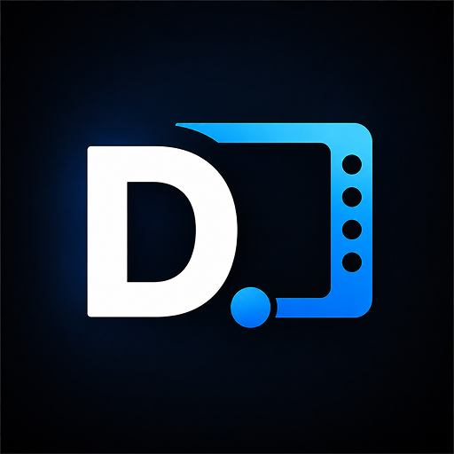
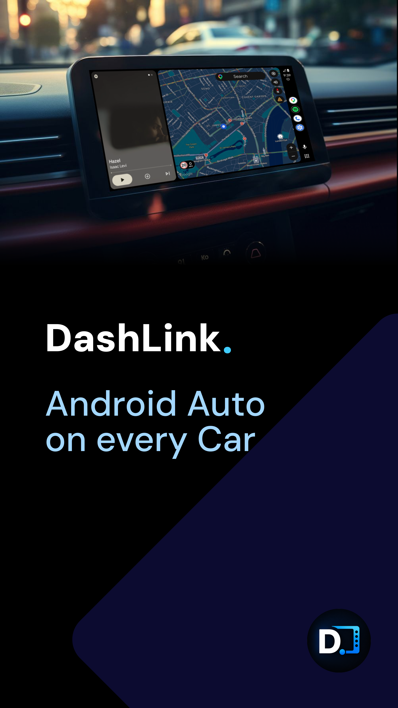
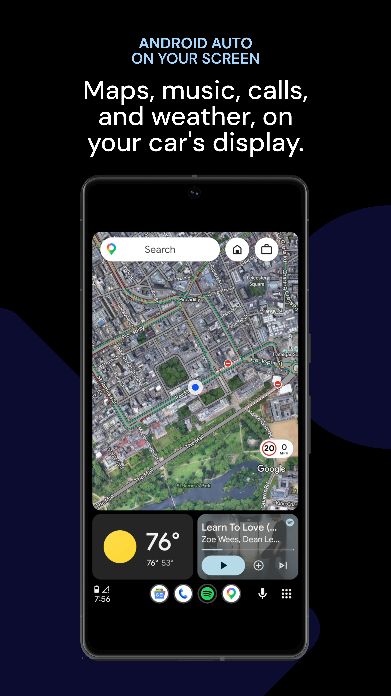
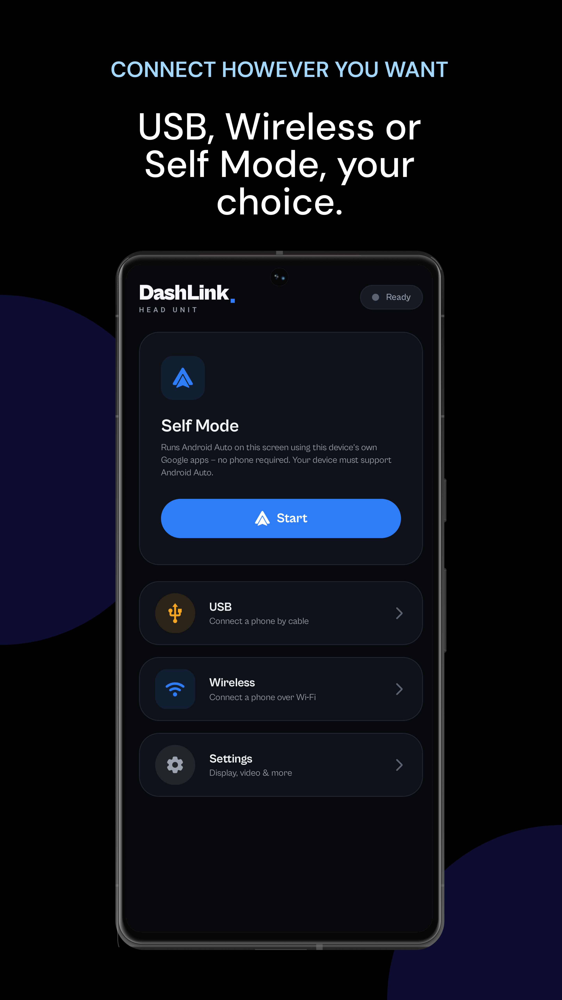
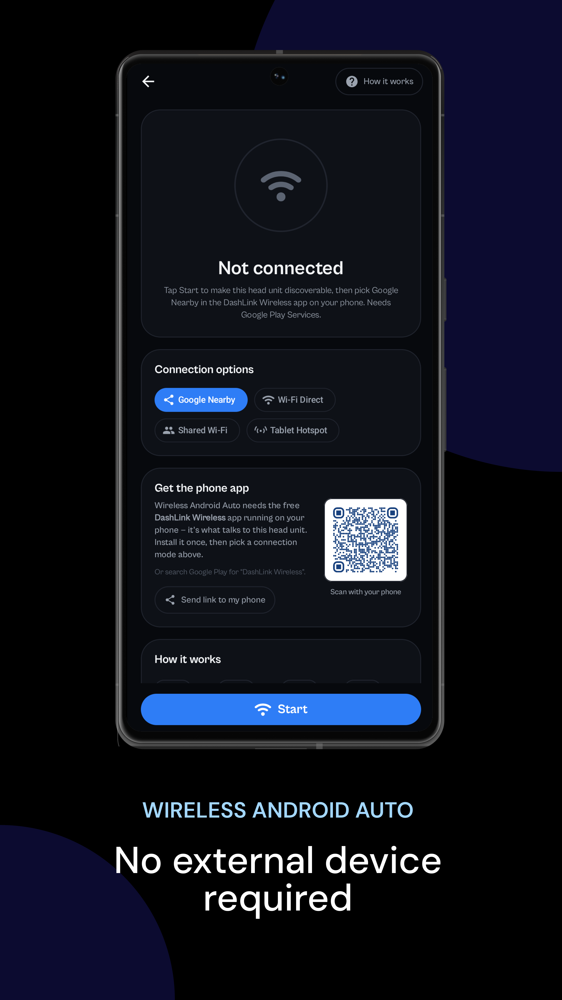
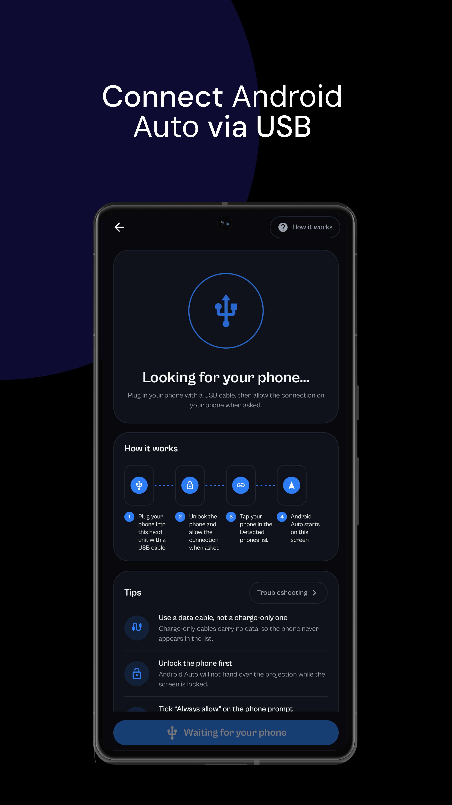
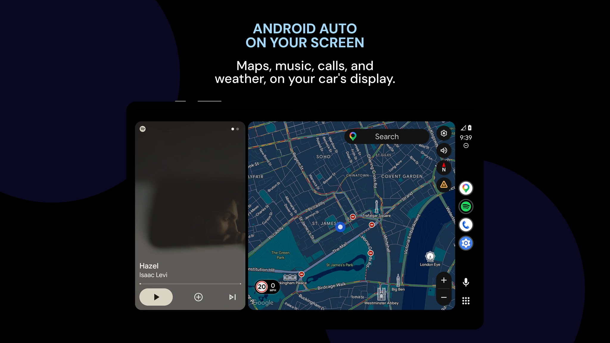

# DashLink Head Unit

**Android Auto Receiver - For Your Car**

Turn your Android head unit, tablet, or car screen into a full Android Auto display.

### [⬇️ Download the latest APK](../../releases/latest)

[Get it on Google Play](https://play.google.com/store/apps/details?id=com.auto.dashlink.headunit)

---

> **No Google Play on your head unit?** Many Android head units ship without the Play Store. This repository exists so you can download the DashLink APK on any device, copy it to a USB drive, and install it straight on your car's screen.

---

## 📱 Screenshots

| | | |
|:---:|:---:|:---:|
|  |  |  |
|  |  |  |

---

## About this app

Turn your Android head unit, tablet, or car screen into a full Android Auto display. DashLink connects your phone and brings **navigation, music, calls, and messaging** to your existing screen. No need to replace your head unit.

> ⚠️ **IMPORTANT: where to install**
> DashLink must be installed on your **car's Android screen** (head unit or tablet), **not on your phone**. Your phone runs Android Auto as usual; DashLink is what displays it on your car's screen.

---

## ✨ Key features

### 📶 Wireless connection
Connect your phone wirelessly using Google Nearby, Wi-Fi Direct, shared Wi-Fi, or tablet hotspot. No cables needed.

### 🔌 USB connection
Plug in with a USB cable for a fast, reliable wired connection.

### 🚗 Self mode
Run Android Auto directly on your DashLink device. No second phone required.

### 📺 Designed for Android devices
Works with Android-based car head units, tablets, and other compatible Android devices.

### ⚙️ Display & performance controls
Adjust resolution, pixel density, orientation, performance mode, screen fitting, and margins to match your device.

---

## ⬇️ How to install on your head unit (via USB)

Most head units don't have Google Play, so install DashLink from a USB stick:

1. **Download the APK.** On your phone or computer, open the [Releases page](../../releases/latest) and download the latest `.apk` file.
2. **Copy it to a USB stick.** Paste the `.apk` file onto a USB stick (FAT32 or exFAT works best). Keep it in the main folder, not inside other folders.
3. **Plug the USB stick into your car's display.** Insert it into the USB port connected to your head unit.
4. **Open the File Manager** on your car's display and browse to the USB stick.
5. **Tap the `.apk` file** to start the installation.
6. **Allow installation if asked.** If the head unit says "Install from unknown sources", turn it on for the File Manager, then tap the `.apk` again.
7. **Tap Install**, wait for it to finish, then open **DashLink** and follow the setup guide below.

---

## 🧭 Setup guide

### Wireless connection
1. Open DashLink on your car screen and select **Wireless**.
2. On your phone, make sure **Wi-Fi and Bluetooth** are both turned on.
3. Follow the on-screen pairing steps to connect your phone to the head unit (Google Nearby, Wi-Fi Direct, shared Wi-Fi, or hotspot, depending on your device).
4. Once paired, Android Auto launches automatically on your car screen.

### USB connection
1. Open DashLink on your car screen and select **USB**.
2. Connect your phone to the head unit using a **USB data cable** (not a charge-only cable).
3. On your phone, allow the USB connection and Android Auto permissions when prompted.
4. Android Auto starts automatically on your car screen.

### Self mode
1. Open DashLink on your car screen and select **Self Mode**.
2. Make sure the DashLink device itself is signed into a Google account with Android Auto compatibility enabled.
3. Android Auto runs directly on the car screen. No phone connection required.

---

## 🆓 Pricing

- **7-day free trial.** No card required.
- After the trial, unlock unlimited use with a one-time purchase.

---

## ✅ Compatibility

DashLink is designed for compatible Android devices and Android Auto configurations. Availability may vary depending on your device, Android version, Google Play services, and connection method. Some features require Google Play services, a compatible Android phone, Wi-Fi, Bluetooth, or USB data connectivity.

---

## 🔄 What's new

Check the [Releases page](../../releases) for the full changelog of every version.

**Latest:** Android Auto wireless connection stabilisation, bug fixes and improvements.

---

## 🔐 Verifying your download

Every release lists a **SHA-256 checksum** next to the APK in the release notes. If you want to confirm your download is intact, compare it with that value. These APKs are the same builds published on Google Play, signed with the same key.

---

## 🛡️ Privacy

Read the full [Privacy Policy](https://parallaxapplications.blogspot.com/2026/08/dashlink-head-unit.html).

---

## ❓ FAQ

**Is this the same app as on Google Play?**
Yes. The APK here is the same build published on Google Play.

**Why is this repo here if the app is on Google Play?**
Many Android head units don't include Google Play, so there's no way to install the app on them directly. This repo gives you a simple download for USB installation.

**Do I install it on my phone?**
No. Install it on your **car's Android screen**. Your phone uses the Android Auto app it already has.

**Will I get updates?**
Updates on a sideloaded install are manual. Watch this repo (⭐ **Watch → Custom → Releases**) to get notified when a new version is out, then repeat the USB install. Installing over the old version keeps your settings.

**Where is the source code?**
This repository only hosts release builds. DashLink is a closed-source app.

**It won't install. What now?**
- Make sure "Install unknown apps" is enabled for your file manager.
- Check that the file finished downloading completely (compare the SHA-256).
- If you're updating, install the new version over the old one. Don't uninstall first.
- Still stuck? [Open an issue](../../issues) with your head unit model and Android version.

---

## 🐞 Support & feedback

- 🐛 **Bugs / requests:** [Open an issue](../../issues)
- 📧 **Email:** appsparallax@gmail.com
- ⭐ If DashLink works for you, please [rate it on Google Play](https://play.google.com/store/apps/details?id=com.auto.dashlink.headunit).

When reporting a problem, please include:
- Head unit brand and model
- Android version
- DashLink version
- Connection method (Wireless / USB / Self mode)
- What happened, and what you expected

---

## ⚖️ Disclaimer

**DashLink Head Unit is an independent third-party application and is not affiliated with, endorsed by, sponsored by, or otherwise officially connected with Google LLC or Android Auto.** Android Auto is a trademark of Google LLC. Google, Android, Android Auto, and their respective logos are the property of their respective owners.

Use connected features safely and in accordance with applicable laws. Do not interact with your device while driving in a way that distracts you from the road.

---

**Developed by Parallax Apps**

[Google Play](https://play.google.com/store/apps/details?id=com.auto.dashlink.headunit) · [Privacy Policy](https://parallaxapplications.blogspot.com/2026/08/dashlink-head-unit.html) · [Releases](../../releases) · [Support](mailto:appsparallax@gmail.com)

